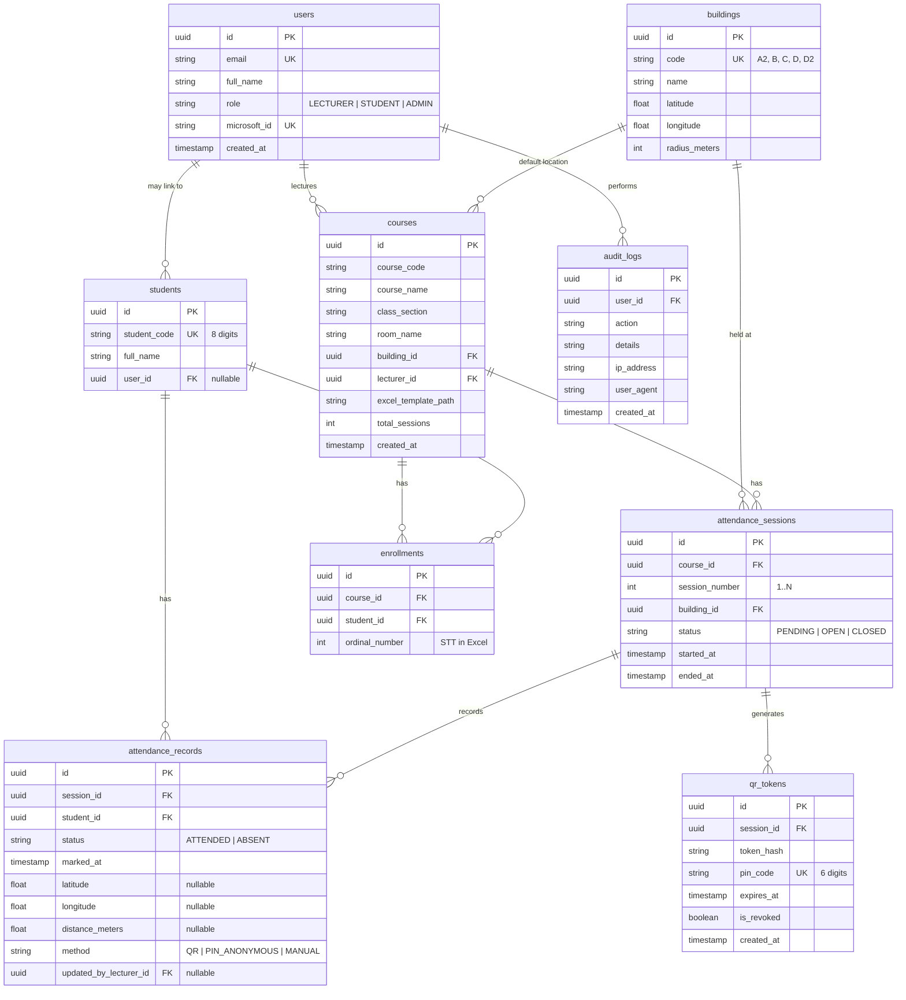

# Database Schema Design

## ERD (Entity-Relationship Diagram)

## Indexes
- `users.email` (UNIQUE)
- `users.microsoft_id` (UNIQUE)
- `students.student_code` (UNIQUE)
- `qr_tokens.pin_code` (UNIQUE, INDEX for fast lookup)
- `attendance_sessions.course_id` (INDEX)
- `enrollments.course_id`, `enrollments.student_id` (UNIQUE composite)
- `attendance_records.session_id`, `attendance_records.student_id` (UNIQUE composite)

