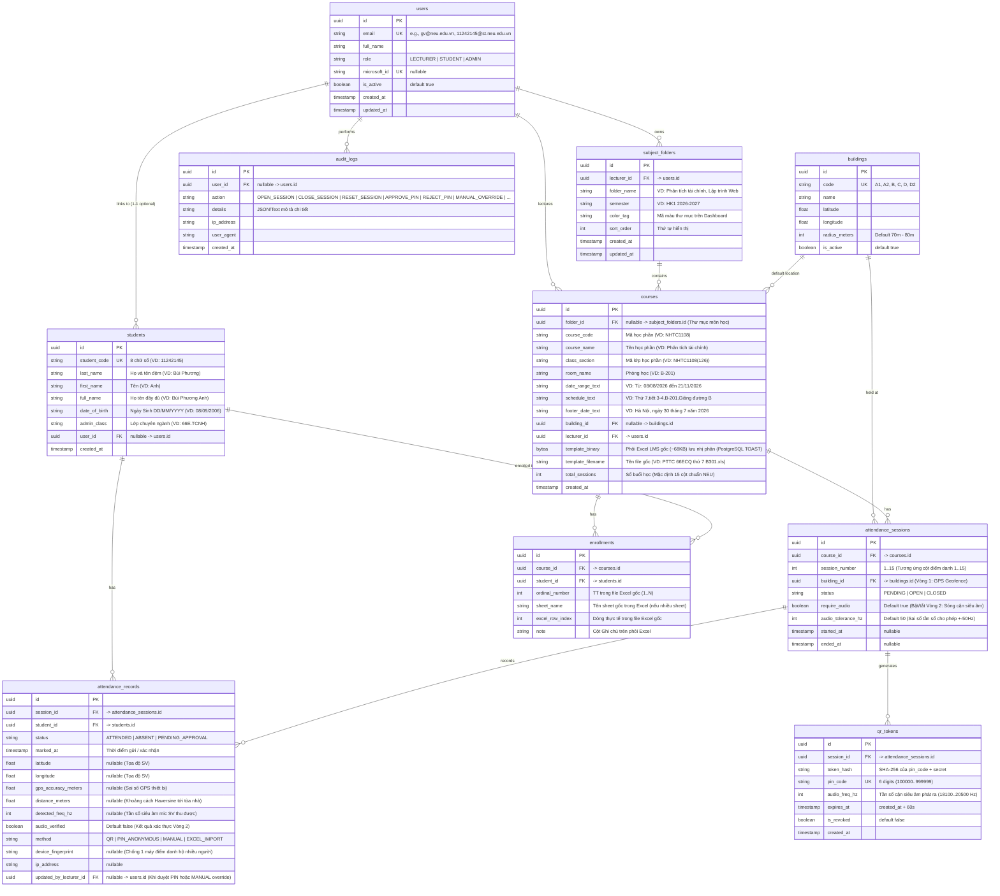

# Database Schema Design - NEU Attendance System

## 1. ERD (Entity-Relationship Diagram - 10 Bảng Chuẩn Hóa)

---

## 2. Chi Tiết 10 Bảng & Ràng Buộc (Constraints & Indexes)

### 2.1. Bảng `users`
- Lưu trữ tài khoản đăng nhập qua Microsoft 365 Entra ID (`@neu.edu.vn` cho Giảng viên, `@st.neu.edu.vn` cho Sinh viên) và Quản trị viên (`ADMIN`).
- **Indexes:**
  - `ix_users_email` (`UNIQUE` trên `email`)
  - `ix_users_microsoft_id` (`UNIQUE` trên `microsoft_id`)

### 2.2. Bảng `subject_folders` (Thư mục Môn học của Giảng viên)
- Phục vụ tổ chức Dashboard của Giảng viên theo cấu trúc cây 2 cấp: **Thư mục Môn học (`SubjectFolder`) $\rightarrow$ Các Lớp học phần (`Course`)**.
- Hỗ trợ tự động gom nhóm (Auto-grouping) khi giảng viên kéo thả nhiều file Excel có cùng dòng tiêu đề `Học phần: <Tên môn>`.
- **Constraints & Indexes:**
  - `uq_lecturer_folder_semester`: `UNIQUE(lecturer_id, folder_name, semester)` — Tên thư mục của cùng một giảng viên trong cùng học kỳ không trùng nhau.
  - `ix_subject_folders_lecturer_id` (`INDEX` trên `lecturer_id`)

### 2.3. Bảng `students` (Hồ sơ Sinh viên khớp 100% phôi Phòng QLĐT NEU)
- Lưu tách biệt đầy đủ 5 trường thông tin cá nhân trên phôi Excel của trường NEU:
  1. `student_code`: Mã số SV 8 chữ số (`11242145`)
  2. `last_name`: Họ và tên đệm (`Bùi Phương`)
  3. `first_name`: Tên (`Anh`) — phục vụ in đậm và sắp xếp chuẩn bảng chữ cái Tiếng Việt trên chế độ **Quick Look Preview**
  4. `date_of_birth`: Ngày Sinh (`08/09/2006`)
  5. `admin_class`: Lớp chuyên ngành/hành chính (`66E.TCNH`)
- **4 trường đối soát bắt buộc cho luồng `PIN_ANONYMOUS`**: Khi sinh viên điểm danh bằng mã PIN không đăng nhập, sinh viên phải nhập đúng cả 4 thông tin (`student_code`, `full_name`, `date_of_birth`, `admin_class`).
- **Indexes:**
  - `ix_students_student_code` (`UNIQUE` trên `student_code`)
  - `ix_students_user_id` (`INDEX` trên `user_id`)

### 2.4. Bảng `buildings`
- Danh mục tọa độ tâm và bán kính phủ sóng của các tòa nhà giảng đường NEU (`A1`, `A2`, `B`, `C`, `D`, `D2`).
- **Indexes:**
  - `ix_buildings_code` (`UNIQUE` trên `code`)

### 2.5. Bảng `courses` & `enrollments`
- `courses`: Lớp học phần nằm trong `subject_folders`, lưu đầy đủ siêu dữ liệu từ phôi Excel (`class_section`, `date_range_text`, `schedule_text`, `footer_date_text`) để dựng giao diện **Quick Look Preview** giống hệt bản in của Phòng Quản lý Đào tạo NEU.
- Hỗ trợ đọc cả file Excel trống mới tinh lẫn **file Excel đã điểm danh sẵn một số buổi trước đó** (`method = 'EXCEL_IMPORT'`).
- **Constraints & Indexes:**
  - `uq_enrollment_course_student`: `UNIQUE(course_id, student_id)`
  - `ix_courses_folder_id` (`INDEX` trên `folder_id`)
  - `ix_enrollments_course_id` (`INDEX` trên `course_id`)

### 2.6. Bảng `attendance_sessions` & `qr_tokens`
- `attendance_sessions`: Đại diện cho từng cột buổi học (`session_number` từ `1..15`).
  - Hỗ trợ thao tác **Reset / Xóa phiên điểm danh (`RESET_SESSION`)**: Xóa toàn bộ `attendance_records` và `qr_tokens` của buổi đó, đưa trạng thái buổi học về lại `PENDING` (cột trống trên phôi Excel).
- `qr_tokens`: Quản lý mã PIN 6 số (`pin_code`) và tần số sóng cận siêu âm (`audio_freq_hz` trong dải $18.100\text{ Hz} - 20.500\text{ Hz}$) có thời hạn 60 giây.
- **Constraints & Indexes:**
  - `uq_session_course_number`: `UNIQUE(course_id, session_number)`
  - `ix_qr_tokens_pin_code` (`UNIQUE` B-Tree Index trên `pin_code`)

### 2.7. Bảng `attendance_records`
- Lưu trạng thái điểm danh 3 giá trị:
  - `ATTENDED`: Đã có mặt (Quét QR có đăng nhập MS365 thành công, hoặc đã được Giảng viên duyệt từ luồng PIN, hoặc Giảng viên tích chọn `MANUAL`, hoặc import sẵn từ file Excel `EXCEL_IMPORT`).
  - `PENDING_APPROVAL`: Sinh viên gửi từ luồng **Mã PIN không đăng nhập (`PIN_ANONYMOUS`)** đã vượt qua kiểm tra 4 thông tin cá nhân + Vòng 1 (GPS) + Vòng 2 (Audio), đang chờ Giảng viên nhìn mặt tại lớp bấm **[Xác nhận Có mặt]**.
  - `ABSENT`: Vắng mặt (Khi đóng phiên mà chưa điểm danh, hoặc bị Giảng viên bấm **[Từ chối]** yêu cầu duyệt PIN, hoặc Giảng viên đánh vắng thủ công).
- **Constraints & Indexes:**
  - `uq_attendance_session_student`: `UNIQUE(session_id, student_id)` — Đảm bảo quy tắc **One-time Attendance per Session**.
