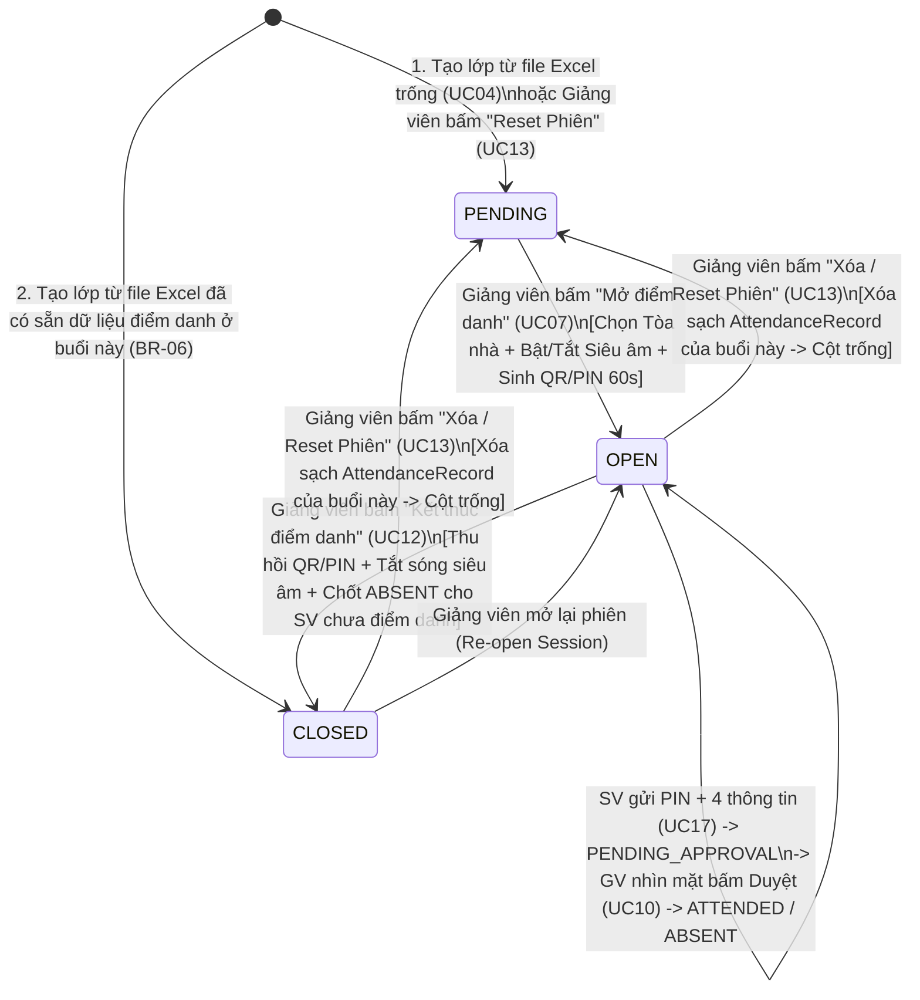

# TÀI LIỆU ĐẶC TẢ QUY TRÌNH VÀ QUY TẮC NGHIỆP VỤ HỆ THỐNG
# HỆ THỐNG ĐIỂM DANH SINH VIÊN ĐA TẦNG BẰNG QR ĐỘNG, ĐỊNH VỊ GPS VÀ SÓNG ÂM CẬN SIÊU ÂM (NEU ATTENDANCE)

---

## MỤC LỤC
1. [Chương 1: Tổng quan hệ thống và Phạm vi nghiệp vụ](#chương-1-tổng-quan-hệ-thống-và-phạm-vi-nghiệp-vụ)
2. [Chương 2: Actors và Ma trận phân quyền](#chương-2-actors-và-ma-trận-phân-quyền)
3. [Chương 3: Luồng sự kiện chính, Vòng đời phiên điểm danh và State Machine](#chương-3-luồng-sự-kiện-chính-vòng-đời-phiên-điểm-danh-và-state-machine)
4. [Chương 4: Quy tắc nghiệp vụ cốt lõi (Business Rules)](#chương-4-quy-tắc-nghiệp-vụ-cốt-lõi-business-rules)
5. [Chương 5: Danh mục Use Case chi tiết](#chương-5-danh-mục-use-case-chi-tiết)
6. [Chương 6: Danh mục và Kịch bản xử lý ngoại lệ (Exceptions)](#chương-6-danh-mục-và-kịch-bản-xử-lý-ngoại-lệ-exceptions)

---

## CHƯƠNG 1: TỔNG QUAN HỆ THỐNG VÀ PHẠM VI NGHIỆP VỤ

### 1.1. Bối cảnh và Mục tiêu
Hệ thống **NEU Attendance** được thiết kế nhằm tự động hóa công tác quản lý lớp học phần và rút ngắn thời gian điểm danh tại các giảng đường Đại học Kinh tế Quốc dân (NEU) xuống dưới **60 giây cho một lớp 60–150 sinh viên**, đồng thời triệt tiêu tuyệt đối mọi hành vi điểm danh hộ:
* Chặn gửi ảnh chụp mã QR / đọc mã PIN cho bạn ở nhà hoặc ký túc xá (nhờ **Mã động 60s + Vòng 1 GPS Tòa nhà**).
* Chặn đứng ngoài hành lang, ngồi ở tầng trên/dưới hoặc quán nước sát giảng đường để lách GPS (nhờ **Vòng 2 Sóng âm thanh cận siêu âm 3D qua Web Audio API**).
* Chặn mang thiết bị thứ 2 (1 điện thoại + 1 laptop) vào lớp để nhập mã PIN điểm danh hộ bạn vắng mặt (nhờ cơ chế **Xác thực 4 trường thông tin cá nhân + Giảng viên nhìn mặt duyệt `PENDING_APPROVAL`**).

### 1.2. Phạm vi vận hành & Quản lý Lớp học theo Thư mục
* **Không gian địa lý phục vụ:** Toàn bộ hệ thống giảng đường nội khu NEU (Tòa nhà Thế kỷ A2, Giảng đường A1, B, C, D, D2).
* **Tổ chức Quản lý dạng Cây Thư mục 2 cấp (`SubjectFolder` $\rightarrow$ `Course`) & Quick Look Preview:**
  * Mỗi học kỳ, giảng viên thường giảng dạy từ 2–4 môn học khác nhau, mỗi môn có từ 2–5 lớp học phần. Hệ thống tổ chức Dashboard của giảng viên theo mô hình **Thư mục Môn học lớn** (VD: *Lập trình Web*, *Lập trình hướng đối tượng*, *Phân tích tài chính*) chứa các **Lớp học phần nhỏ** bên trong.
  * Hỗ trợ upload **file Excel phôi gốc hoặc file Excel đã điểm danh sẵn một số buổi trước đó** (`.xls` hoặc `.xlsx` đa sheet xuất từ LMS của Phòng Quản lý Đào tạo NEU).
  * Trang bị chế độ **Xem trước nhanh (Quick Look Preview)** giống như tính năng bấm phím `Space` trên macOS: tái hiện chính xác 100% bố cục trang in của Phòng Quản lý Đào tạo NEU (`TT`, `Lớp`, `Mã số SV`, `Họ và tên đệm`, `Tên`, `Ngày Sinh`, 15 cột `Số lần điểm danh 1..15`, `Ghi chú`) ngay trên trình duyệt.

### 1.3. Cơ chế Xác thực Hiện diện Vật lý 2 Vòng (2-Ring Physical Presence Verification)

* **Cổng vào — Mã QR Động & Mã PIN 6 Số (Chu kỳ 60 giây - `BR-08`):**
  * Khi giảng viên mở phiên điểm danh, hệ thống sinh mã PIN 6 chữ số (`pin_code`) và hiển thị mã QR nhúng đường dẫn trực tiếp `{{base_url}}/student/{pin_code}` lên màn chiếu.
  * Lưu ý: **Website không tích hợp trình mở camera quét QR bên trong web**. Sinh viên sử dụng trực tiếp ứng dụng Camera mặc định / Zalo / trình quét mã có sẵn trên điện thoại để quét mã QR trên màn chiếu và mở thẳng đường link trong trình duyệt.

* **Vòng 1 — Kiểm tra Không gian 2D Tòa nhà: Định vị GPS (`BR-11`):**
  * Khoảng cách mặt đất $d$ từ tọa độ thiết bị sinh viên $(\varphi_{\text{sv}}, \lambda_{\text{sv}})$ đến tâm Tòa nhà giảng đường $(\varphi_{\text{b}}, \lambda_{\text{b}})$ được tính bằng **công thức Haversine**:
    $$d = 2R \cdot \arcsin\left(\sqrt{\sin^2\left(\frac{\Delta \varphi}{2}\right) + \cos(\varphi_1)\cos(\varphi_2)\sin^2\left(\frac{\Delta \lambda}{2}\right)}\right) \le \text{radius\_meters} + \min(\text{accuracy\_sv}, 100\text{ m})$$

* **Vòng 2 — Kiểm tra Không gian 3D Phòng học: Sóng Âm Cận Siêu Âm (`BR-09`, `BR-13`, `BR-14`):**
  * **Nguyên lý vật lý 3D:** Sóng âm tần số cao ($18.100\text{ Hz} - 20.500\text{ Hz}$) bị chặn hoàn toàn bởi tường gạch, cửa kính đóng kín và sàn bê tông giữa các tầng.
  * **Trên máy tính Giảng viên (Bộ phát):** Trình duyệt dùng `OscillatorNode` (sóng `sine`) phát tần số `audio_freq_hz` được nhảy tần động (**Dynamic Frequency Hopping**) từ 25 kênh chuẩn ($18.100\text{ Hz} \rightarrow 20.500\text{ Hz}$, cách nhau $100\text{ Hz}$) mỗi khi sinh mã QR/PIN 60s mới. Giảng viên có công tắc **Bật/Tắt Sóng cận siêu âm (`require_audio`)** ngay lúc mở phiên điểm danh (`BR-15`).
  * **Trên thiết bị Sinh viên (Bộ thu):** Khi đã cấp quyền Microphone, trình duyệt thu âm trong 1,5–2,5 giây với cấu hình **tắt toàn bộ bộ lọc ồn của smartphone** (`echoCancellation: false`, `noiseSuppression: false`, `autoGainControl: false`), phân tích phổ FFT (`AnalyserNode`, `fftSize = 8192`, độ phân giải $\approx 5,86\text{ Hz/bin}$) để tìm tần số đỉnh `detected_freq_hz`:
    $$|\text{detected\_freq\_hz} - \text{audio\_freq\_hz}| \le \text{audio\_tolerance\_hz} \quad (\text{Mặc định: } \pm 50\text{ Hz})$$

---

## CHƯƠNG 2: ACTORS VÀ MA TRẬN PHÂN QUYỀN

### 2.1. Định nghĩa danh mục Actor
| STT | Actor | Mã Vai Trò (`role`) | Mô tả | Yêu cầu đăng nhập |
| :---: | :--- | :---: | :--- | :---: |
| 1 | **Sinh viên điểm danh bằng PIN** (*PIN Fallback Student*) | `PUBLIC` | Sinh viên gặp sự cố điện thoại (hết pin, lỗi 2FA, mạng lag) sử dụng máy tính/laptop hoặc mượn thiết bị để điểm danh qua mã PIN. | Không |
| 2 | **Sinh viên chính quy** (*Authenticated Student*) | `STUDENT` | Sinh viên dùng điện thoại cá nhân quét mã QR trên màn chiếu và đăng nhập Microsoft 365 (`@st.neu.edu.vn`). | Có |
| 3 | **Giảng viên** (*Lecturer*) | `LECTURER` | Cán bộ giảng dạy đăng nhập qua Microsoft 365 (`@neu.edu.vn`), quản lý thư mục môn học, lớp học phần và điều hành điểm danh. | Có |
| 4 | **Quản trị viên** (*Administrator*) | `ADMIN` | Quản trị viên kỹ thuật quản lý danh mục tòa nhà, cấu hình mạng và nhật ký kiểm toán bảo mật. | Có |

---

### 2.2. Ma trận phân quyền chức năng tổng quát
| Nhóm chức năng | Chức năng chi tiết | SV Nhập PIN (`PUBLIC`) | Sinh viên (`STUDENT`) | Giảng viên (`LECTURER`) | Quản trị viên (`ADMIN`) |
| :--- | :--- | :---: | :---: | :---: | :---: |
| **Xác thực** | Đăng nhập Microsoft 365 / Mock Auth (Dev) | Cho phép | Cho phép | Cho phép | Cho phép |
| | Xem hồ sơ người dùng hiện tại (`/auth/me`) | Không | Cho phép | Cho phép | Cho phép |
| **Thư mục & Lớp học** | Quản lý Thư mục Môn học (Tạo, Sửa tên/màu, Xóa) | Không | Không | Cho phép | Cho phép |
| | Upload file Excel LMS (Gốc hoặc Đã điểm danh 1 số buổi) | Không | Không | Cho phép | Cho phép |
| | Quản lý Lớp học phần (Xem, Sửa phòng, Di chuyển, Xóa lớp) | Không | Không | Cho phép (Lớp mình dạy) | Cho phép |
| | Xem trước nhanh phôi Excel (**Quick Look Preview**) | Không | Không | Cho phép | Cho phép |
| **Phiên điểm danh** | Mở phiên điểm danh (`OPEN`) & Tùy chọn Bật/Tắt Siêu âm | Không | Không | Cho phép | Không |
| | Trình chiếu QR + PIN 60s & Phát sóng cận siêu âm | Không | Không | Cho phép | Không |
| | Làm mới mã QR/PIN & Nhảy tần số siêu âm (`refresh-qr`) | Không | Không | Cho phép | Không |
| | Theo dõi Realtime & **Duyệt/Từ chối SV điểm danh bằng PIN** | Không | Không | Cho phép | Không |
| | Can thiệp thủ công Có mặt / Vắng mặt (`MANUAL`) | Không | Không | Cho phép | Không |
| | Đóng phiên điểm danh (`CLOSED`) & Chốt vắng mặt | Không | Không | Cho phép | Không |
| | **Xóa / Đặt lại (Reset) Phiên điểm danh về `PENDING`** | Không | Không | Cho phép | Không |
| **Thực hiện điểm danh** | Kiểm tra mã PIN 6 số khả dụng | Cho phép | Cho phép | Cho phép | Cho phép |
| | Điểm danh qua link QR + Đăng nhập MS365 (`ATTENDED` ngay) | Không | Cho phép | Không | Không |
| | Điểm danh qua PIN + 4 thông tin cá nhân (`PENDING_APPROVAL`) | Cho phép | Cho phép | Không | Không |
| | Xem lịch sử chuyên cần cá nhân theo môn học | Không | Cho phép | Không | Không |
| **Báo cáo & Quản trị** | Xuất file Excel kết quả điểm danh chuẩn phôi NEU | Không | Không | Cho phép | Cho phép |
| | Quản lý danh mục Tòa nhà & Bán kính Geofence | Không | Không | Chỉ xem | Cho phép (CRUD) |
| | Xem Nhật ký bảo mật (`audit_logs`) & Cấu hình mạng | Không | Không | Cho phép (IP LAN) | Cho phép |

---

## CHƯƠNG 3: LUỒNG SỰ KIỆN CHÍNH, VÒNG ĐỜI PHIÊN ĐIỂM DANH VÀ STATE MACHINE

### 3.1. Luồng Sự Kiện Chính Tổng Thể (End-to-End Core Operational Flow)

Toàn bộ quá trình vận hành thực tế trên giảng đường diễn ra theo đúng trình tự 4 giai đoạn sau:

1. **Giai đoạn 1 — Tổ chức Thư mục Môn học & Tải lên File Excel (Giảng viên):**
   * Giảng viên đăng nhập vào Dashboard, tạo các **Thư mục Môn học** cho học kỳ (ví dụ: *Lập trình Web*, *Lập trình hướng đối tượng*, *Phân tích tài chính*).
   * Giảng viên tải file Excel danh sách lớp từ LMS (`.xls` hoặc `.xlsx`) vào thư mục. File này có thể là **file gốc chưa điểm danh buổi nào** hoặc **file đã được điểm danh sẵn ở một số buổi trước đó** (đã có số `1` ở một vài cột từ `1..15`).
   * Hệ thống tự động bóc tách thông tin lớp, danh sách sinh viên (`TT`, `Lớp`, `Mã số SV`, `Họ và tên đệm`, `Tên`, `Ngày Sinh`, `Ghi chú`) và nạp sẵn dữ liệu các buổi đã điểm danh (nếu có). Giảng viên có thể bấm **Quick Look Preview** để xem lại toàn bộ bảng biểu giống hệt như mở trên macOS.

2. **Giai đoạn 2 — Mở Phiên Điểm Danh & Phát Tín Hiệu (Giảng viên):**
   * Đến giờ học, giảng viên chọn Lớp học phần $\rightarrow$ Chọn Buổi học số $N$ (`1..15`).
   * Ngay tại hộp thoại mở phiên, giảng viên kiểm tra Tòa nhà giảng đường (Vòng 1 GPS) và **tùy chọn Bật hoặc Tắt Sóng cận siêu âm (Vòng 2 Audio - `require_audio`)**.
   * Màn hình giảng viên / Máy chiếu hiển thị **Mã QR động** (nhúng URL `{{base_url}}/student/{pin_code}`) cùng **Mã PIN 6 số** có hiệu lực 60 giây, đồng thời phát sóng âm cận siêu âm `audio_freq_hz` ra loa phòng học.

3. **Giai đoạn 3A — Luồng Chính: Sinh viên có điện thoại Quét QR & Đăng nhập Microsoft 365 (`method = 'QR'`):**
   * Sinh viên dùng **ứng dụng Camera / trình quét QR có sẵn trên điện thoại** (trang web không có bộ quét QR bên trong) để quét mã QR trên màn chiếu $\rightarrow$ Điện thoại mở trình duyệt truy cập vào đường link `{{base_url}}/student/{pin_code}`.
   * Sinh viên thực hiện **Đăng nhập tài khoản Microsoft 365** (`@st.neu.edu.vn` có xác thực 2FA Authenticator).
   * Sau khi đăng nhập xong, giao diện hiển thị bước yêu cầu sinh viên bấm **Cấp quyền truy cập Vị trí (GPS)** và **Cấp quyền truy cập Microphone** của trình duyệt.
   * Khi đã cấp quyền xong, sinh viên bấm nút **"Xác nhận điểm danh"**. Trình duyệt thu thập tọa độ GPS (Vòng 1) + thu mẫu tần số siêu âm qua FFT trong 1,5–2 giây (Vòng 2) và gửi lên Server.
   * Server đối soát hợp lệ $\rightarrow$ Ghi nhận ngay trạng thái **`ATTENDED` (Có mặt)** và cập nhật lên màn chiếu của giảng viên.

4. **Giai đoạn 3B — Luồng Dự Phòng: Sinh viên không dùng được điện thoại, Điểm danh bằng Mã PIN (`method = 'PIN_ANONYMOUS'`):**
   * Khi sinh viên không thể dùng điện thoại cá nhân (hết pin, lỗi xác thực 2FA Authenticator, mạng di động lag), sinh viên sử dụng thiết bị khác (trình duyệt trên laptop/máy tính cá nhân hoặc mượn điện thoại bạn).
   * Sinh viên truy cập vào URL cơ bản của trang web `{{base_url}}`, chọn mục **"Điểm danh sinh viên"** để nhập **Mã PIN 6 số** (hoặc truy cập thẳng URL có đính kèm mã PIN `{{base_url}}/student/{pin_code}`).
   * Server kiểm tra nếu **Mã PIN khả dụng** (đang trong thời hạn 60s và phiên đang `OPEN`) thì chuyển sang trang khai báo thông tin điểm danh.
   * Tại trang này, sinh viên thực hiện:
     1. **Cấp quyền truy cập Vị trí (GPS) và Microphone** trên trình duyệt của thiết bị đang dùng.
     2. **Nhập chính xác 4 thông tin cá nhân khớp với phôi Excel của trường:**
        * **Mã sinh viên** (`student_code`, VD: `11242145`)
        * **Họ và tên** (`full_name`, VD: `Bùi Phương Anh`)
        * **Ngày sinh** (`date_of_birth`, VD: `08/09/2006`)
        * **Lớp chuyên ngành** (`admin_class`, VD: `66E.TCNH`)
     3. Bấm nút **"Gửi"** để gửi dữ liệu điểm danh.
   * **Xử lý chống điểm danh hộ bằng thiết bị thứ 2 (`PENDING_APPROVAL`):**
     * Nếu cả 4 thông tin cá nhân + Vòng 1 (GPS) + Vòng 2 (Audio) + Khóa thiết bị (`device_fingerprint`) đều hợp lệ, hệ thống ghi nhận trạng thái **`PENDING_APPROVAL` (Chờ Giảng viên xác nhận)** và hiển thị ngay thẻ cảnh báo nổi màu vàng trên màn chiếu của giảng viên:
       *"SV Bùi Phương Anh (11242145 - 66E.TCNH) điểm danh qua Mã PIN — Đề nghị SV giơ tay xác nhận"* kèm 2 nút **[Xác nhận Có mặt]** / **[Từ chối]**.
     * Giảng viên nhìn xuống lớp thấy sinh viên giơ tay $\rightarrow$ Bấm **[Xác nhận Có mặt]** $\rightarrow$ Trạng thái chuyển thành **`ATTENDED`**.

---

### 3.2. Sơ đồ Trạng thái Phiên Điểm Danh (`AttendanceSession`) & Bản ghi Điểm Danh (`AttendanceRecord`)



---

### 3.3. Sơ đồ Luồng Xác thực Chi tiết cho 2 Phương thức (`QR` vs `PIN_ANONYMOUS`)

```mermaid
flowchart TD
    subgraph Flow_QR["LUỒNG 1: ĐIỂM DANH BẰNG QUÉT QR (CÓ ĐĂNG NHẬP MS365)"]
        Q1([SV dùng Camera ĐT quét QR trên màn chiếu]) --> Q2[Mở link trình duyệt /student/pin_code]
        Q2 --> Q3[Đăng nhập Microsoft 365 @st.neu.edu.vn + 2FA]
        Q3 --> Q4[Cấp quyền Vị trí GPS & Microphone trên trình duyệt]
        Q4 --> Q5[Bấm nút 'Xác nhận điểm danh']
        Q5 --> Check_Common{Kiểm tra Mã PIN 60s\n+ Vòng 1 GPS\n+ Vòng 2 Sóng Siêu Âm\n+ Device Lock}
    end

    subgraph Flow_PIN["LUỒNG 2: ĐIỂM DANH BẰNG MÃ PIN (KHÔNG ĐĂNG NHẬP)"]
        P1([SV mở web trên Laptop / Máy mượn]) --> P2[Vào mục 'Điểm danh sinh viên' nhập Mã PIN 6 số\nhoặc vào thẳng link có mã PIN]
        P2 --> P3{Server kiểm tra\nMã PIN khả dụng?}
        P3 -->|Hết hạn / Sai| ErrPIN([Báo lỗi EX-04: Mã PIN không khả dụng])
        P3 -->|Khả dụng| P4[Chuyển sang Trang nhập 4 thông tin:\n1. Mã SV | 2. Họ và tên\n3. Ngày sinh | 4. Lớp chuyên ngành]
        P4 --> P5[Cấp quyền Vị trí GPS & Microphone\n+ Nhập đủ 4 thông tin + Bấm 'Gửi']
        P5 --> P6{Kiểm tra khớp 100%\n4 thông tin trong Lớp?}
        P6 -->|Sai thông tin| ErrInfo([Báo lỗi EX-06: Thông tin không khớp])
        P6 -->|Khớp chính xác| Check_Common
    end

    Check_Common -->|Vi phạm GPS / Audio / Trùng thiết bị| ErrVerify([Từ chối: EX-08 / EX-10 / EX-12])
    Check_Common -->|Hợp lệ & Từ Luồng 1 QR| AutoAttend([Ghi nhận ngay ATTENDED\nCập nhật xanh trên màn chiếu GV])
    Check_Common -->|Hợp lệ & Từ Luồng 2 PIN| PendingApprove[Ghi nhận PENDING_APPROVAL\nBật thẻ vàng trên màn chiếu GV:\n'Đề nghị SV giơ tay xác nhận']
    
    PendingApprove -->|GV nhìn mặt & bấm Duyệt| Approved([Chuyển thành ATTENDED])
    PendingApprove -->|GV bấm Từ chối| Rejected([Chuyển thành ABSENT + Ghi AuditLog])
```

---

## CHƯƠNG 4: QUY TẮC NGHIỆP VỤ CỐT LÕI (BUSINESS RULES)

### 4.1. Nhóm Tài khoản Microsoft 365 & Định danh Sinh viên
* **BR-01 (Xác thực tổ chức NEU):** Hệ thống xác thực người dùng qua Microsoft OAuth 2.0 / Entra ID, chỉ chấp nhận tên miền `@neu.edu.vn` và `@st.neu.edu.vn` (hỗ trợ `DEV_MOCK_AUTH = true` trong môi trường phát triển/kiểm thử).
* **BR-02 (Phân loại vai trò tự động):** Email `@neu.edu.vn` được gán vai trò `LECTURER` (hoặc `ADMIN`); email `@st.neu.edu.vn` được gán vai trò `STUDENT`.
* **BR-03 (Trích xuất Mã sinh viên tự động):** Tự động tách **8 chữ số đầu tiên** từ email `[Mã_SV]@st.neu.edu.vn` làm `student_code` và liên kết với hồ sơ sinh viên trong bảng `students`.

### 4.2. Nhóm Quản lý Thư mục Môn học, Lớp học phần & Phôi Excel NEU
* **BR-04 (Tổ chức Cây Thư mục 2 cấp `SubjectFolder` $\rightarrow$ `Course`):**
  * Mỗi giảng viên quản lý các lớp học phần của mình bên trong các **Thư mục Môn học (`subject_folders`)**. Tên thư mục của cùng một giảng viên trong cùng học kỳ là duy nhất.
  * Khi giảng viên upload 1 hoặc nhiều file Excel mà không chọn trước thư mục, hệ thống tự động đọc dòng tiêu đề `Học phần: <Tên môn>` trong file Excel để gom lớp vào thư mục trùng tên (nếu chưa có thư mục đó thì tự động khởi tạo).
* **BR-05 (Chuẩn hóa Cấu trúc Cột theo Phôi Phòng Quản lý Đào tạo NEU):**
  * Bộ đọc `ExcelService` hỗ trợ cả định dạng `.xls` và `.xlsx` trên **toàn bộ các Sheet**, bóc tách chính xác các trường siêu dữ liệu (`Mã lớp học phần`, `Tên học phần`, `Thời gian học Từ... đến...`, `Lịch học & Phòng học`, `Ngày tháng năm chân trang`) và 6 cột thông tin sinh viên:
    1. `TT` (`ordinal_number`)
    2. `Lớp` (`admin_class` — Lớp chuyên ngành, VD: `66E.TCNH`)
    3. `Mã số SV` (`student_code` — 8 chữ số, VD: `11242145`)
    4. `Họ và tên đệm` (`last_name`, VD: `Bùi Phương`)
    5. `Tên` (`first_name`, VD: `Anh`)
    6. `Ngày Sinh` (`date_of_birth` — định dạng `DD/MM/YYYY`, VD: `08/09/2006`)
* **BR-06 (Lưu trữ Nhị phân Phôi Excel trong DB + Cache Redis & Import Buổi Cũ):**
  * File phôi Excel tải lên (~68 KB) được lưu trực tiếp dưới dạng nhị phân (`template_binary` kiểu `BYTEA` trong PostgreSQL TOAST) kèm cấu trúc JSON được đẩy lên **Redis Cache** (`course:{id}:quicklook`) để phục vụ chế độ **Quick Look Preview** với tốc độ $< 1\text{ms}$ mà không phụ thuộc vào ổ cứng cục bộ của từng Backend Server.
  * Khi đọc các cột điểm danh từ `1` đến `15` dưới nhóm cột `Số lần điểm danh`, nếu cột buổi thứ $K$ đã có dữ liệu đánh dấu đi học (ký tự `1`, `x`, `X`, `✓`), hệ thống tự động chuyển trạng thái buổi $K$ sang `CLOSED` và khởi tạo bản ghi `AttendanceRecord` (`status = 'ATTENDED'`, `method = 'EXCEL_IMPORT'`) cho những sinh viên có dấu, và `status = 'ABSENT'` cho những sinh viên để trống ở buổi $K$ đó. Các cột buổi học còn trống hoàn toàn được giữ ở trạng thái `PENDING`.

### 4.3. Nhóm Vòng đời Phiên điểm danh, QR/PIN Động & Phát sóng Siêu âm
* **BR-07 (Ràng buộc Phiên Điểm Danh & Quy tắc Reset Phiên):**
  * Mỗi buổi học thứ $K$ (`1..15`) của một lớp học phần có duy nhất 01 bản ghi `AttendanceSession`.
  * **Xóa / Đặt lại (Reset) Phiên điểm danh (`UC13`):** Khi giảng viên thực hiện Reset buổi học thứ $K$ (do mở nhầm buổi hoặc mở thử nghiệm), hệ thống thu hồi toàn bộ `qr_tokens`, xóa sạch toàn bộ `attendance_records` của buổi $K$ đó và đưa trạng thái buổi $K$ quay về `PENDING` (trả lại cột trống hoàn toàn trên bản Preview Excel).
* **BR-08 (Vòng đời Mã QR & PIN động 60 giây - Quét bằng Camera Điện thoại):**
  * Mỗi mã `pin_code` (6 chữ số `100000`–`999999`) và đường dẫn QR `{{base_url}}/student/{pin_code}` có thời hạn sống đúng **60 giây**. Khi tạo mã mới hoặc đóng/reset phiên, mọi mã cũ bị thu hồi (`is_revoked = true`).
  * Sinh viên dùng ứng dụng Camera / trình quét QR sẵn có trên điện thoại để quét mã trên màn chiếu và mở trình duyệt (website không nhúng bộ quét camera bên trong).
* **BR-09 (Cơ chế Nhảy tần Sóng Cận Siêu Âm - Dynamic Frequency Hopping):** Mỗi mã `QRToken` 60s được gắn kèm một tần số `audio_freq_hz` chọn ngẫu nhiên từ 25 kênh chuẩn trong dải **$18.100\text{ Hz} - 20.500\text{ Hz}$** (cách nhau $100\text{ Hz}$), không trùng với tần số liền trước.
* **BR-10 (An toàn Thính giác khi phát Sóng Siêu Âm):** Máy tính giảng viên phát sóng hình sin thuần (`type = 'sine'`) qua `OscillatorNode` và bắt buộc dùng `linearRampToValueAtTime` ($30\text{ms}-50\text{ms}$) khi bật/tắt hoặc chuyển tần số để triệt tiêu tiếng "bụp/tách" trên loa hội trường.

### 4.4. Nhóm Xác thực Hiện diện 2 Vòng & Chốt chặn Chống Điểm danh hộ
* **BR-11 (Bắt buộc Kiểm tra Vòng 1 - GPS Geofencing):** Áp dụng cho cả luồng QR và luồng PIN. Khoảng cách Haversine $d$ từ vị trí thiết bị sinh viên tới tâm Tòa nhà giảng đường phải thỏa mãn:
  $$d \le \text{radius\_meters} + \min(\text{accuracy}, 100\text{ m})$$
* **BR-12 (Quy tắc Xác thực 4 Thông tin Cá nhân & Duyệt tại lớp cho Luồng PIN):**
  * **Luồng 1 (`QR` - Có đăng nhập Microsoft 365):** Sinh viên phải đăng nhập `@st.neu.edu.vn`, mã SV thuộc danh sách lớp $\rightarrow$ Khi vượt qua Vòng 1 (GPS) và Vòng 2 (Audio), hệ thống ghi nhận ngay **`status = 'ATTENDED'`** (`method = 'QR'`).
  * **Luồng 2 (`PIN_ANONYMOUS` - Không đăng nhập, dùng cho thiết bị dự phòng):**
    1. Sau khi nhập mã PIN 6 số khả dụng, sinh viên **bắt buộc phải nhập đúng cả 4 trường thông tin**: `Mã số SV` (`student_code`), `Họ và tên` (`full_name`), `Ngày Sinh` (`date_of_birth`), và `Lớp chuyên ngành` (`admin_class`) khớp chính xác với dữ liệu phôi Excel của lớp.
    2. Sau khi vượt qua kiểm tra 4 thông tin + Vòng 1 (GPS) + Vòng 2 (Audio), bản ghi được đưa vào trạng thái **`status = 'PENDING_APPROVAL'`** và hiển thị cảnh báo nổi trên màn chiếu của giảng viên để sinh viên giơ tay tại lớp xác nhận. Chỉ khi giảng viên bấm **[Xác nhận Có mặt]**, trạng thái mới chuyển sang **`ATTENDED`**.
* **BR-13 (Bắt buộc Tắt Bộ lọc Ồn Smartphone khi thu Sóng Siêu Âm):** Khi gọi `navigator.mediaDevices.getUserMedia`, trình duyệt của sinh viên bắt buộc tắt toàn bộ bộ lọc âm thanh: `echoCancellation: false`, `noiseSuppression: false`, `autoGainControl: false`, `sampleRate: { ideal: 48000 }`, và phân tích bằng `AnalyserNode` (`fftSize = 8192`).
* **BR-14 (Kiểm tra Vòng 2 - Đối soát Tần số Đỉnh Sóng Cận Siêu Âm):** Nếu phiên bật `require_audio = true`, tần số đỉnh `detected_freq_hz` thu được trong dải $15\text{kHz} - 22\text{kHz}$ phải thỏa mãn:
  $$|\text{detected\_freq\_hz} - \text{audio\_freq\_hz}| \le \text{audio\_tolerance\_hz} \quad (\text{Mặc định: } \pm 50\text{ Hz})$$
* **BR-15 (Tùy chọn Bật/Tắt Sóng Cận Siêu Âm `require_audio`):** Giảng viên có thể tùy chọn bật hoặc tắt Vòng 2 ngay khi mở phiên điểm danh (hoặc trong lúc đang chiếu) nếu phòng học hỏng loa.

### 4.5. Nhóm Chống Gian lận Thiết bị, Quick Look Preview, Override & Xuất Excel
* **BR-16 (Chống Điểm danh trùng & Khóa Thiết bị Điểm danh hộ - Anti-Proxy Device Lock):**
  * Mỗi sinh viên chỉ có tối đa 01 bản ghi điểm danh trong 1 buổi học (`UNIQUE(session_id, student_id)`).
  * Mỗi thiết bị vật lý (`device_fingerprint`) chỉ được phép gửi điểm danh thành công cho **tối đa 01 Mã sinh viên trong cùng một phiên điểm danh**.
* **BR-17 (Cập nhật Realtime qua WebSocket):** Đẩy tức thời các sự kiện `ATTENDANCE_MARKED`, `PIN_APPROVAL_REQUESTED`, `QR_REFRESHED`, `SESSION_CLOSED`, `SESSION_RESET` tới màn hình máy chiếu của giảng viên.
* **BR-18 (Chốt danh sách Vắng mặt khi Đóng phiên):** Khi giảng viên bấm "Kết thúc điểm danh" (`close`), mọi sinh viên chưa `ATTENDED` (bao gồm cả các yêu cầu `PENDING_APPROVAL` không được duyệt) sẽ được chuyển sang `ABSENT`.
* **BR-19 (Chế độ Xem trước Quick Look Preview & Xuất File Excel chuẩn NEU):**
  * Trên giao diện **Quick Look Preview**, bảng điểm danh được hiển thị đúng nguyên mẫu của Phòng Quản lý Đào tạo NEU: Quốc hiệu, tiêu đề lớp, bảng danh sách sinh viên với cột `Tên` in đậm và 15 cột điểm danh (`1..15`).
  * Khi xuất file Excel (`.xlsx`) tải về máy, các ô điểm danh có trạng thái `ATTENDED` được điền số **`1`**, các ô `ABSENT` hoặc `PENDING` **để trống**, giữ nguyên 100% bố cục, phông chữ và phần chữ ký cuối trang (`Người lập danh sách`, `Cán bộ giảng dạy`, `Xác nhận bộ môn`).
* **BR-20 (Can thiệp Thủ công & Bảo vệ Xóa Dữ liệu):**
  * Giảng viên có thể click đổi trạng thái `ATTENDED` $\leftrightarrow$ `ABSENT` (`method = 'MANUAL'`) ngay trên màn hình phiên học hoặc click đúp trực tiếp vào ô lưới trên màn hình **Quick Look Preview**.
  * Khi xóa Lớp học phần hoặc xóa Thư mục Môn học đang chứa lớp học phần đã có dữ liệu điểm danh, hệ thống bắt buộc yêu cầu xác nhận bảo mật để chống xóa nhầm.

---

## CHƯƠNG 5: DANH MỤC USE CASE CHI TIẾT

Hệ thống được chuẩn hóa toàn bộ các Use Case liên tục từ **UC01** đến **UC22**, tuyệt đối không đứt đoạn và ánh xạ chính xác với các Business Rules (`BR-01`..`BR-20`) và Ngoại lệ (`EX-01`..`EX-18`):

| Mã UC | Tên Use Case | Actor thực hiện | Mức ưu tiên | BR áp dụng | Mã Ngoại lệ liên quan | Mô tả phạm vi nghiệp vụ |
| :---: | :--- | :--- | :---: | :--- | :--- | :--- |
| **UC01** | Đăng nhập Microsoft 365 / Dev Auth | Giảng viên, Sinh viên, Admin | Must | BR-01, BR-02, BR-03 | EX-01 | Xác thực OAuth2 NEU; tự động gán role và tách 8 số MSSV từ email. |
| **UC02** | Xem hồ sơ người dùng hiện tại | Giảng viên, Sinh viên, Admin | Must | BR-01, BR-02 | EX-01 | Kiểm tra JWT token và trả về thông tin người dùng đang đăng nhập. |
| **UC03** | Quản lý Thư mục Môn học (CRUD `SubjectFolder`) | Giảng viên | Must | BR-04, BR-20 | EX-17 | Tạo mới thư mục môn học theo kỳ, đổi tên/màu sắc, xóa thư mục (giữ lớp hoặc xóa kèm lớp). |
| **UC04** | Upload file Excel LMS tạo Lớp học phần | Giảng viên | Must | BR-04, BR-05, BR-06 | EX-02, EX-03 | Upload 1 hoặc nhiều file `.xls`/`.xlsx` (gốc hoặc đã điểm danh 1 số buổi); tự động gom vào thư mục môn học. |
| **UC05** | Quản lý Lớp học phần (Xem, Sửa, Di chuyển, Xóa lớp) | Giảng viên | Must | BR-04, BR-05, BR-20 | EX-17 | Sửa phòng học/tòa nhà, di chuyển lớp giữa các thư mục môn học, xóa lớp học phần. |
| **UC06** | Xem trước nhanh phôi Excel (**Quick Look Preview**) | Giảng viên | Must | BR-05, BR-19, BR-20 | - | Bấm nút Preview / phím `Space` để xem toàn màn hình phôi bảng điểm danh chuẩn NEU (`1..15`) ngay trên web. |
| **UC07** | Mở phiên điểm danh & Tùy chọn Bật/Tắt Siêu âm | Giảng viên | Must | BR-07, BR-08, BR-09, BR-15 | EX-09 | Chọn buổi `1..15`, xác nhận Tòa nhà (Vòng 1), bật/tắt Sóng cận siêu âm (Vòng 2), sinh QR/PIN đầu tiên. |
| **UC08** | Trình chiếu QR/PIN 60s & Phát sóng Cận Siêu Âm | Giảng viên | Must | BR-08, BR-09, BR-10 | EX-11 | Chiếu mã QR + PIN 6 số lên màn hình lớp học và phát sóng `sine` tần số `audio_freq_hz` qua loa. |
| **UC09** | Làm mới mã QR/PIN & Nhảy tần số âm thanh | Giảng viên | Must | BR-08, BR-09, BR-10 | EX-09 | Hủy mã 60s cũ, sinh mã PIN mới và nhảy sang kênh tần số siêu âm mới. |
| **UC10** | Theo dõi Realtime & Duyệt yêu cầu điểm danh PIN tại lớp | Giảng viên | Must | BR-12, BR-17 | EX-14 | Xem danh sách có mặt nhảy số tức thì; bấm **[Xác nhận Có mặt]** hoặc **[Từ chối]** khi SV điểm danh bằng PIN giơ tay. |
| **UC11** | Can thiệp điểm danh thủ công (Manual Override) | Giảng viên | Must | BR-17, BR-20 | EX-06 | Đổi trạng thái Có mặt (`1`) $\leftrightarrow$ Vắng mặt (trống) trên bảng phiên học hoặc trực tiếp trên lưới Quick Look Preview. |
| **UC12** | Kết thúc phiên điểm danh & Chốt vắng mặt | Giảng viên | Must | BR-07, BR-08, BR-18 | EX-09 | Đóng phiên (`CLOSED`), thu hồi mọi QR/PIN, tắt sóng siêu âm, gán `ABSENT` cho SV chưa điểm danh. |
| **UC13** | Xóa / Đặt lại (Reset) Phiên điểm danh về `PENDING` | Giảng viên | Must | BR-07, BR-17, BR-20 | - | Xóa toàn bộ dữ liệu điểm danh của một buổi mở nhầm/chạy thử, đưa buổi học về lại trạng thái chưa diễn ra (`PENDING`). |
| **UC14** | Xuất file Excel kết quả điểm danh chuẩn LMS | Giảng viên | Must | BR-05, BR-19 | EX-15 | Điền số `1` vào các ô có mặt trên phôi Excel chuẩn của trường NEU và tải về máy. |
| **UC15** | Kiểm tra mã PIN 6 số khả dụng | Sinh viên (`STUDENT` / `PUBLIC`) | Must | BR-08, BR-15 | EX-04, EX-09 | Kiểm tra mã PIN 6 số còn hạn 60s hay không để điều hướng vào màn hình điểm danh. |
| **UC16** | Điểm danh bằng Quét QR (Camera ĐT + Đăng nhập MS365) | Sinh viên (`STUDENT`) | Must | BR-03, BR-08, BR-11, BR-12, BR-13, BR-14, BR-16, BR-17 | EX-01, EX-04, EX-05, EX-06, EX-07, EX-08, EX-10, EX-12 | Quét QR bằng ĐT $\rightarrow$ Mở web & Login MS365 $\rightarrow$ Cấp quyền Vị trí & Mic $\rightarrow$ Bấm "Xác nhận điểm danh" $\rightarrow$ `ATTENDED`. |
| **UC17** | Điểm danh bằng Mã PIN (Nhập 4 thông tin + Duyệt tại lớp) | Sinh viên (`PUBLIC`) | Must | BR-08, BR-11, BR-12, BR-13, BR-14, BR-16, BR-17 | EX-04, EX-05, EX-06, EX-07, EX-08, EX-10, EX-12, EX-13, EX-18 | Nhập PIN $\rightarrow$ Cấp quyền Vị trí & Mic $\rightarrow$ Nhập `[Mã SV, Họ tên, Ngày sinh, Lớp chuyên ngành]` $\rightarrow$ `PENDING_APPROVAL`. |
| **UC18** | Xem lịch sử chuyên cần cá nhân | Sinh viên (`STUDENT`) | Should | BR-03 | EX-01 | Sinh viên đăng nhập xem thống kê các buổi Có mặt / Vắng mặt của các môn đang học. |
| **UC19** | Quản lý danh mục Tòa nhà & Bán kính GPS | Quản trị viên (`ADMIN`) | Should | BR-11 | EX-16 | Thêm, sửa tọa độ tâm `(lat, lng)` và bán kính `radius_meters` của các giảng đường NEU. |
| **UC20** | Cấu hình địa chỉ IP/Host mạng nội bộ | Giảng viên, Admin | Should | BR-08 | - | Cập nhật IP LAN/Domain để link trong mã QR trên màn chiếu trỏ đúng về máy chủ. |
| **UC21** | Tra cứu Nhật ký kiểm toán bảo mật (`AuditLog`) | Quản trị viên (`ADMIN`) | Could | BR-20 | - | Xem lịch sử mở/đóng/reset phiên, duyệt PIN, override và cảnh báo gian lận thiết bị. |
| **UC22** | Tự động đồng bộ dữ liệu điểm danh sẵn có từ Excel | Hệ thống | Must | BR-05, BR-06 | EX-02 | Tự động phát hiện và import trạng thái các buổi học đã có sẵn số `1` khi giảng viên upload file Excel dở dang. |

---

## CHƯƠNG 6: DANH MỤC VÀ KỊCH BẢN XỬ LÝ NGOẠI LỆ (EXCEPTIONS)

Danh mục ngoại lệ được đánh số liền mạch từ **EX-01** đến **EX-18** và quy định rõ kịch bản xử lý chuẩn trên toàn hệ thống:

| Mã EX | Giai đoạn | Tình huống ngoại lệ | Kịch bản xử lý của hệ thống |
| :---: | :--- | :--- | :--- |
| **EX-01** | Đăng nhập | Tài khoản không thuộc tên miền `@neu.edu.vn` / `@st.neu.edu.vn` hoặc JWT hết hạn. | Chặn truy cập (HTTP 401/403), hiển thị thông báo yêu cầu đăng nhập đúng tài khoản Microsoft 365 của trường NEU. |
| **EX-02** | Upload Excel | File tải lên không đúng định dạng `.xls` / `.xlsx` hoặc bị hỏng cấu trúc nhị phân. | Từ chối xử lý (HTTP 400), thông báo: *"Chỉ hỗ trợ file Excel danh sách lớp định dạng .xlsx hoặc .xls xuất từ LMS"*. |
| **EX-03** | Upload Excel | File Excel không tìm thấy các cột chuẩn (`Mã số SV`, `Họ và tên đệm`, `Tên`) ở bất kỳ Sheet nào. | Từ chối tạo lớp (HTTP 400), chỉ rõ thiếu cột định danh sinh viên và hướng dẫn tải đúng phôi từ LMS. |
| **EX-04** | Kiểm tra PIN | Mã PIN 6 số không tồn tại, đã bị thu hồi hoặc đã hết hạn sau 60 giây. | Chặn chuyển trang (HTTP 400/404), thông báo: *"Mã PIN không khả dụng hoặc đã hết hạn 60s. Vui lòng nhìn lên màn chiếu để lấy mã mới nhất!"*. |
| **EX-05** | Điểm danh | Sinh viên đã `ATTENDED` hoặc đang `PENDING_APPROVAL` trong buổi học này nhưng gửi lại. | Chặn ghi đè (HTTP 400), thông báo rõ trạng thái hiện tại của sinh viên (Đã điểm danh thành công / Đang chờ giảng viên xác nhận). |
| **EX-06** | Điểm danh PIN | Sinh viên nhập sai bất kỳ thông tin nào trong **4 trường bắt buộc**: `Mã số SV`, `Họ và tên`, `Ngày sinh`, `Lớp chuyên ngành`. | Từ chối điểm danh (HTTP 400), thông báo: *"Thông tin cá nhân (Mã SV, Họ tên, Ngày sinh hoặc Lớp chuyên ngành) không khớp với danh sách lớp học phần"*. |
| **EX-07** | Cấp quyền Thiết bị | Sinh viên chưa cấp quyền hoặc từ chối cấp quyền Vị trí (GPS) / Microphone trên trình duyệt. | Khóa nút *"Xác nhận điểm danh"* / *"Gửi"*, hiển thị hướng dẫn bật quyền Vị trí & Micro trên trình duyệt và nút kiểm tra lại quyền. |
| **EX-08** | Vòng 1 (GPS) | Khoảng cách Haversine từ sinh viên tới Tòa nhà vượt quá `radius_meters + accuracy`. | Từ chối điểm danh (HTTP 400), thông báo rõ khoảng cách lệch: *"Vị trí quá xa (Cách [X]m). Hãy di chuyển vào khu vực giảng đường [Tên Tòa Nhà]"*. |
| **EX-09** | Phiên điểm danh | Sinh viên gửi yêu cầu khi phiên điểm danh đang ở trạng thái `PENDING` hoặc đã `CLOSED`. | Từ chối điểm danh (HTTP 400), thông báo: *"Phiên điểm danh buổi này hiện đang đóng. Vui lòng liên hệ Giảng viên"*. |
| **EX-10** | Vòng 2 (Audio) | Thiết bị sinh viên không bắt được tần số cận siêu âm của phòng học hoặc lệch quá $\pm 50\text{ Hz}$ (do đứng ngoài hành lang/khác tầng). | Từ chối điểm danh (HTTP 400), thông báo: *"Không nhận diện được tín hiệu âm thanh phòng học (Vòng 2). Vui lòng ngồi trong phòng học và thử lại"*. |
| **EX-11** | Vòng 2 (Audio) | Máy tính phòng học hỏng loa khiến cả lớp không bắt được sóng siêu âm. | Giảng viên bấm nút tắt nhanh công tắc **"Sóng cận siêu âm"** (`require_audio = false`) ngay trên màn hình trình chiếu để cả lớp điểm danh qua Vòng 1 (GPS). |
| **EX-12** | Chống gian lận | Một thiết bị (`device_fingerprint`) cố tình điểm danh cho sinh viên thứ 2 trong cùng một phiên học. | Chặn yêu cầu (HTTP 403), ghi nhận vào `audit_logs` và thông báo: *"Thiết bị này đã được sử dụng để điểm danh trong buổi học hôm nay"*. |
| **EX-13** | Quá tải / Tốc độ | Sinh viên hoặc script tự động bắn liên tiếp nhiều request dò mã PIN 6 số (Brute-force PIN). | Tầng Rate Limiter (Redis) chặn IP tạm thời (HTTP 429 Too Many Requests) nếu gửi sai mã PIN quá 10 lần/phút. |
| **EX-14** | Realtime WS | Mất kết nối mạng tạm thời giữa máy tính Giảng viên và WebSocket Server. | Giao diện Projector tự động thực hiện Reconnect ngầm sau mỗi 2 giây và đồng bộ lại danh sách qua REST API. |
| **EX-15** | Xuất Excel | File template gốc bị xóa khỏi ổ cứng hoặc lỗi định dạng cũ khi xuất báo cáo. | Hệ thống tự động tái tạo file Excel đúng chuẩn bố cục Phòng Quản lý Đào tạo NEU từ dữ liệu Database để giảng viên tải về bình thường. |
| **EX-16** | Quản trị | Xóa tòa nhà đang được gắn với lớp học phần hoặc phiên điểm danh. | Chặn xóa cứng (HTTP 400), chỉ cho phép chuyển trạng thái `is_active = false` hoặc cập nhật lại tọa độ. |
| **EX-17** | Quản lý Thư mục/Lớp | Giảng viên tạo thư mục trùng tên trong cùng học kỳ hoặc bấm xóa Thư mục/Lớp học phần đã có dữ liệu điểm danh. | Chặn tạo trùng tên (HTTP 400); khi xóa Thư mục/Lớp đã có dữ liệu, bắt buộc bật hộp thoại cảnh báo xác nhận 2 bước trước khi xóa. |
| **EX-18** | Duyệt PIN tại lớp | Sinh viên gửi yêu cầu điểm danh qua mã PIN (`PENDING_APPROVAL`) nhưng khi giảng viên gọi tên không có mặt trong phòng học. | Giảng viên bấm nút **[Từ chối]** ngay trên màn chiếu $\rightarrow$ Hệ thống chuyển bản ghi sang `ABSENT` và ghi log cảnh báo gian lận vào `audit_logs`. |

---

## TỔNG KẾT VÀ BẢO ĐẢM TOÀN VẸN
1. **Quản lý Thư mục Môn học & Quick Look Preview chuẩn macOS:** Giúp giảng viên quản lý hàng chục lớp học phần mỗi kỳ cực kỳ ngăn nắp theo từng môn, hỗ trợ upload cả file gốc lẫn file đã điểm danh dở dang, xem trước bảng điểm danh chuẩn phôi Phòng Quản lý Đào tạo NEU và có quyền Reset phiên nếu mở nhầm.
2. **Luồng Điểm danh Chuẩn Thực Tế:**
   * Sinh viên có điện thoại dùng trực tiếp ứng dụng Camera/QR trên máy để quét mã mở link web $\rightarrow$ Đăng nhập MS365 $\rightarrow$ Cấp quyền Vị trí & Mic $\rightarrow$ Bấm *"Xác nhận điểm danh"* là hoàn tất (`ATTENDED`).
   * Sinh viên gặp sự cố điện thoại vào mục *"Điểm danh sinh viên"* nhập mã PIN 6 số $\rightarrow$ Cấp quyền Vị trí & Mic $\rightarrow$ Nhập đủ **4 thông tin (`Mã SV`, `Họ tên`, `Ngày sinh`, `Lớp chuyên ngành`)** $\rightarrow$ Chuyển sang `PENDING_APPROVAL` để giảng viên nhìn mặt tại lớp bấm duyệt, khóa chặt 100% kẽ hở dùng máy thứ 2 điểm danh hộ.
3. **Tính toàn vẹn số liệu:** Toàn bộ Actors (4), Business Rules (`BR-01` – `BR-20`), Use Cases (`UC01` – `UC22`) và Exceptions (`EX-01` – `EX-18`) được đánh số liên tục, không đứt đoạn và đồng bộ 100% với ERD 10 bảng tại [`database/docs/schema_design.md`](file:///Users/macprom2/Documents/NEU%20Agent/Code/Website%20giúp%20giảng%20viên%20điểm%20danh%20sinh%20viên%20nhanh%20chóng/database/docs/schema_design.md).
