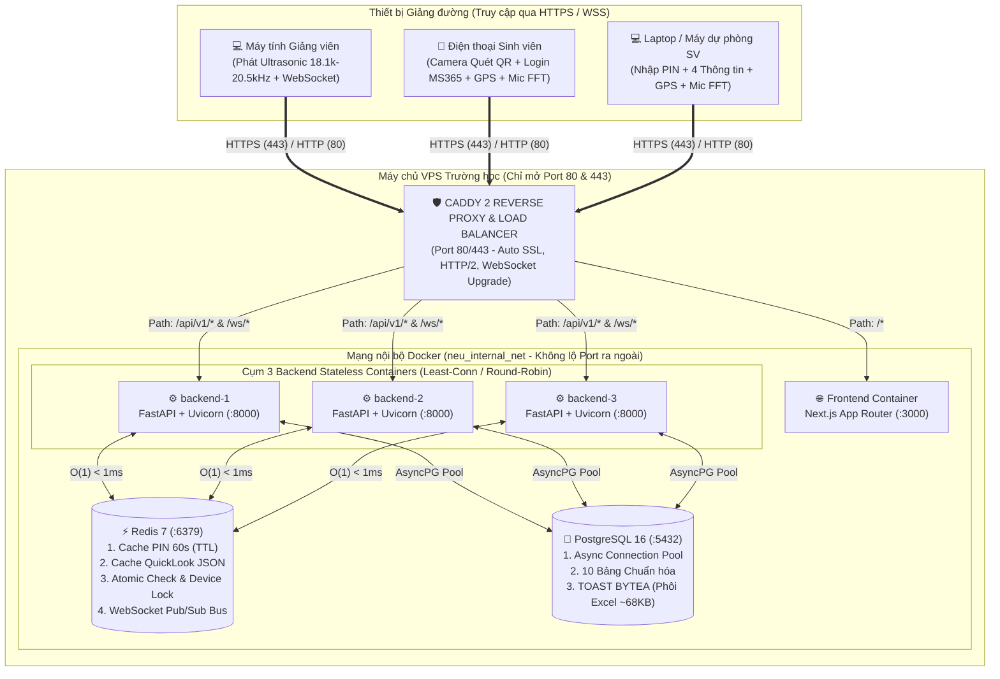
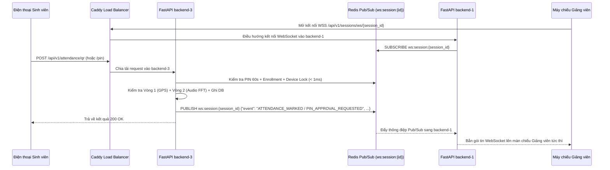

# TÀI LIỆU THIẾT KẾ KIẾN TRÚC HỆ THỐNG (SYSTEM DESIGN SPECIFICATION)
# HỆ THỐNG ĐIỂM DANH SINH VIÊN ĐA TẦNG NEU ATTENDANCE

> [!IMPORTANT]
> **Dành cho AI Coding Agents & Developers:** Tài liệu này quy định kiến trúc hạ tầng, cơ chế cân bằng tải (Caddy), cấu trúc khóa bộ nhớ đệm (Redis Key Schema), đồng bộ thời gian thực (WebSocket Pub/Sub), chiến lược lưu trữ phôi Excel (`BYTEA` TOAST) và quản lý kết nối Database (Connection Pooling). Mọi đoạn mã Backend, Frontend và Docker **bắt buộc** phải tuân thủ thiết kế trong tài liệu này.

---

## MỤC LỤC
1. [Chương 1: Đặc thù Lưu lượng & Kiến trúc Tổng thể trên 1 VPS](#chương-1-đặc-thù-lưu-lượng--kiến-trúc-tổng-thể-trên-1-vps)
2. [Chương 2: Tầng Cân bằng tải & Điều hướng với Caddy 2](#chương-2-tầng-cân-bằng-tải--điều-hướng-với-caddy-2)
3. [Chương 3: Thiết kế Tầng In-Memory Redis 7 & Chuẩn hóa Key Schema](#chương-3-thiết-kế-tầng-in-memory-redis-7--chuẩn-hóa-key-schema)
4. [Chương 4: Kiến trúc Đồng bộ WebSocket Đa Server qua Redis Pub/Sub](#chương-4-kiến-trúc-đồng-bộ-websocket-đa-server-qua-redis-pubsub)
5. [Chương 5: Chiến lược Lưu trữ Phôi Excel (PostgreSQL BYTEA TOAST + Redis QuickLook)](#chương-5-chiến-lược-lưu-trữ-phôi-excel-postgresql-bytea-toast--redis-quicklook)
6. [Chương 6: Quản lý Cơ sở dữ liệu PostgreSQL 16 (Connection Pooling & Indexing)](#chương-6-quản-lý-cơ-sở-dữ-liệu-postgresql-16-connection-pooling--indexing)
7. [Chương 7: Quy tắc Bất biến dành cho AI Agents khi Viết Code Hệ thống](#chương-7-quy-tắc-bất-biến-dành-cho-ai-agents-khi-viết-code-hệ-thống)

---

## CHƯƠNG 1: ĐẶC THÙ LƯU LƯỢNG & KIẾN TRÚC TỔNG THỂ TRÊN 1 VPS

### 1.1. Bài toán "Thundering Herd / Flash Crowd" tại Giảng đường
Khác với các hệ thống web thông thường có lưu lượng rải đều trong ngày, hệ thống điểm danh đại học chịu tải theo dạng **Xung đột biến cực đại (Flash Crowd)** vào đúng thời điểm đầu hoặc cuối mỗi ca học (7h00, 9h00, 13h00, 15h00):
* Khi hàng chục giảng đường đồng loạt chiếu mã QR/PIN có thời hạn sống đúng **60 giây**, hàng nghìn sinh viên sẽ đồng thời truy cập đường dẫn, thu mẫu sóng siêu âm 2 giây, lấy tọa độ GPS và gửi `POST /api/v1/attendance/{qr, pin}` trong cùng một cửa sổ **15–30 giây**.
* Đồng thời, hàng chục màn hình máy chiếu của giảng viên duy trì kết nối **WebSocket** liên tục để nhận thông báo nhảy số sĩ số và duyệt yêu cầu PIN (`PENDING_APPROVAL`) theo thời gian thực.

### 1.2. Sơ đồ Kiến trúc Triển khai trên 1 VPS (Single-Entrypoint Topology)
Toàn bộ hệ thống được đóng gói trong mạng nội bộ Docker (`neu_internal_net`) trên **1 VPS duy nhất**, sử dụng **Caddy 2** làm cổng giao tiếp duy nhất ra bên ngoài:



### 1.3. Quy hoạch Cổng mạng (Port Mapping) & Định mức Tài nguyên VPS

#### A. Nguyên tắc Cổng mạng (Zero Exposed Internal Ports)
* **Trên Firewall của VPS mở ra ngoài:** Chỉ mở cổng **`80` (HTTP)** và **`443` (HTTPS)** cho container `caddy` (cùng cổng `22` cho SSH quản trị).
* **Bên trong mạng Docker (`expose` nội bộ, không `ports` ra host):**
  * `frontend`: lắng nghe nội bộ tại `frontend:3000`.
  * `backend-1`, `backend-2`, `backend-3`: lắng nghe nội bộ tại `backend-1:8000`, `backend-2:8000`, `backend-3:8000`.
  * `redis`: lắng nghe nội bộ tại `redis:6379`.
  * `postgres`: lắng nghe nội bộ tại `postgres:5432`.

#### B. Định mức Cấu hình VPS được cung cấp từ phía nhà trường cho dự án
| Cấu hình | Thông số | Mục đích đáp ứng |
| :--- | :--- | :--- |
| **Toàn trường** | **8 vCPU – 16 GB RAM – 300 GB SSD** | Phục vụ 10.000+ SV điểm danh đồng thời; dư dả bộ nhớ đệm cho Redis & PostgreSQL. |


---

## CHƯƠNG 2: TẦNG CÂN BẰNG TẢI & ĐIỀU HƯỚNG VỚI CADDY 2

### 2.1. Vai trò của Caddy 2
1. **Single Origin (Chống lỗi CORS & Cho phép mở Micro/GPS trên Mobile):** Cả giao diện Frontend (`/*`) và toàn bộ API/WebSocket (`/api/v1/*`) đều đi qua cùng một tên miền HTTPS duy nhất. Nhờ đó trình duyệt iOS Safari và Android Chrome luôn coi trang web là **Secure Context** hợp lệ để cấp quyền Vị trí (Geolocation) và Microphone (`getUserMedia`).
2. **Load Balancing 3 cổng Backend:** Tự động phân phối lưu lượng vào 3 container `backend-1`, `backend-2`, `backend-3` theo thuật toán `least_conn` (ưu tiên server đang ít kết nối nhất) và tự động cô lập container bị lỗi qua cơ chế `health_uri /health`.

### 2.2. Cấu hình `Caddyfile` Chuẩn
```caddyfile
{
    # Bật SSL nội bộ cho HTTPS (:443) và cho phép truy cập trực tiếp cả HTTP (:80)
    local_certs
    auto_https disable_redirects
}

{$DOMAIN_OR_IP:localhost}, :80 {
    # 1. Điều hướng toàn bộ REST API và WebSocket vào cụm 3 Backend
    handle /api/v1/* {
        reverse_proxy backend-1:8000 backend-2:8000 backend-3:8000 {
            lb_policy least_conn
            health_uri /health
            health_interval 10s
            health_timeout 3s
        }
    }

    # 2. Điều hướng toàn bộ giao diện người dùng vào Frontend Next.js
    handle /* {
        reverse_proxy frontend:3000
    }
}
```

---

## CHƯƠNG 3: THIẾT KẾ TẦNG IN-MEMORY REDIS 7 & CHUẨN HÓA KEY SCHEMA

Để đảm bảo 3 cổng Backend hoàn toàn **Stateless** và chịu được tải hàng nghìn request/giây trong cửa sổ 60 giây mà không làm nghẽn PostgreSQL, **Redis 7** đảm nhiệm 6 nhóm khóa (Keys) với quy ước đặt tên bắt buộc như sau:

| STT | Mẫu Key (Key Pattern) | Kiểu dữ liệu | TTL (Thời hạn) | Mục đích & Cơ chế hoạt động |
| :---: | :--- | :---: | :---: | :--- |
| **1** | `qr:pin:{pin_code}` | `STRING` (JSON) | **60 giây** (`EX 60`) | Lưu thông tin mã PIN 6 số đang hoạt động: `{"session_id", "course_id", "audio_freq_hz", "require_audio", "tolerance_hz", "building_lat", "building_lng", "radius_meters"}`. Tự động hủy đúng giây thứ 61 mà không cần truy vấn DB. |
| **2** | `session:{session_id}:enrolled` | `HASH` | **2 giờ** (`EX 7200`) | Khi mở phiên (`UC07`), nạp danh sách SV của lớp vào Hash: Field là `student_code`, Value là JSON `{"student_id", "full_name", "date_of_birth", "admin_class"}`. Giúp đối soát tư cách SV và 4 thông tin cá nhân ở tốc độ $\mathcal{O}(1)$. |
| **3** | `session:{session_id}:marked` | `SET` | **2 giờ** (`EX 7200`) | Chứa tập hợp `student_id` đã điểm danh (`ATTENDED` hoặc `PENDING_APPROVAL`) trong phiên. Dùng lệnh nguyên tử `SADD` để chặn tuyệt đối lỗi bấm đúp (Race Condition `EX-05`) trước khi chạm vào PostgreSQL. |
| **4** | `session:{session_id}:device:{fp}` | `STRING` | **2 giờ** (`NX EX 7200`) | Thực thi quy tắc **Anti-Proxy Device Lock (`BR-16`)**: Lưu `student_code` đầu tiên sử dụng thiết bị có `device_fingerprint = fp` trong phiên. Dùng cờ `NX` (chỉ ghi nếu chưa tồn tại); nếu thiết bị điểm danh cho SV thứ 2 sẽ bị từ chối ngay (`EX-12`). |
| **5** | `course:{course_id}:quicklook` | `STRING` (JSON) | **1 giờ** (`EX 3600`) | Lưu bản cache JSON ma trận bảng điểm danh chuẩn phôi Phòng QLĐT NEU phục vụ cửa sổ **Quick Look Preview (`UC06`)** dưới $1\text{ms}$. Tự động xóa cache (`DEL`) mỗi khi có thay đổi điểm danh trong lớp. |
| **6** | `ratelimit:pin:{client_ip}` | `STRING` (Int) | **60 giây** (`EX 60`) | Đếm số lần nhập sai mã PIN hoặc gửi sai thông tin liên tiếp từ 1 địa chỉ IP. Nếu vượt quá **10 lần/phút**, trả về `HTTP 429 Too Many Requests` (`EX-13`). |

---

## CHƯƠNG 4: KIẾN TRÚC ĐỒNG BỘ WEBSOCKET ĐA SERVER QUA REDIS PUB/SUB

### 4.1. Bài toán khi chạy 3 cổng Backend
Khi chạy 3 container Backend (`backend-1`, `backend-2`, `backend-3`) phía sau Caddy:
* Máy tính của Giảng viên (màn chiếu) có thể đang giữ kết nối WebSocket tại **`backend-1`**.
* Nhưng điện thoại của Sinh viên khi bấm nút *"Xác nhận điểm danh"* hoặc gửi yêu cầu duyệt PIN lại được Caddy điều hướng vào **`backend-3`**.
* Nếu `websocket_manager.py` chỉ lưu danh sách kết nối trong bộ nhớ RAM cục bộ của từng container, **`backend-1` sẽ không hề biết sinh viên vừa điểm danh ở `backend-3`**, dẫn đến màn chiếu không cập nhật!

### 4.2. Giải pháp chuẩn: Redis Pub/Sub Bridge
Mọi sự kiện thời gian thực của phiên học đều được phát qua kênh Redis Pub/Sub có tên **`ws:session:{session_id}`**:



---

## CHƯƠNG 5: CHIẾN LƯỢC LƯU TRỮ PHÔI EXCEL (POSTGRESQL `BYTEA` TOAST + REDIS QUICKLOOK)

Hệ thống **không sử dụng thư mục `uploads/` trên ổ cứng** và **không dùng MinIO**, mà áp dụng kiến trúc lưu trữ kép siêu tốc:

### 5.1. Lưu Phôi Gốc Nhị Phân (`BYTEA` TOAST) trong Bảng `courses`
* Mỗi file Excel danh sách lớp của NEU (`.xls` hoặc `.xlsx` như `PTTC 66ECQ thứ 7 B301.xls`) chỉ có kích thước khoảng **50 KB – 80 KB**.
* File gốc được lưu trực tiếp vào cột `template_binary` (kiểu `BYTEA` / `LargeBinary`) trong bảng `courses`.
* **Cơ chế tối ưu của PostgreSQL TOAST:**
  * PostgreSQL tự động nén và tách dữ liệu `BYTEA` $> 2\text{ KB}$ sang vùng lưu trữ phụ (**Out-of-line TOAST storage**).
  * Trong SQLAlchemy ORM, cột `template_binary` được cấu hình `deferred(Column(LargeBinary))` — nghĩa là mọi câu lệnh truy vấn `Course` thông thường **không bao giờ tải cột nhị phân này vào RAM**.
  * Chỉ khi Giảng viên bấm nút **"Xuất file Excel" (`UC14`)**, hệ thống mới đọc `template_binary` của đúng lớp đó ra bộ nhớ (`BytesIO`), điền số `1` vào các ô điểm danh tương ứng và trả file về trình duyệt.

### 5.2. Lợi ích Kiến trúc
1. **100% Stateless:** Cả 3 container Backend đều đọc/xuất được phôi Excel của mọi lớp học phần mà không cần chia sẻ ổ cứng.
2. **Không bao giờ có file rác mồ côi:** Khi Giảng viên xóa Lớp học phần (`DELETE FROM courses` - `UC05`), dữ liệu nhị phân của phôi Excel tự động được dọn sạch cùng bản ghi.
3. **Xem trước `Quick Look Preview` (`UC06`) dưới $1\text{ms}$:** Giao diện Quick Look đọc trực tiếp cấu trúc JSON từ Redis (`course:{id}:quicklook`) hoặc từ các bảng `courses`, `students`, `enrollments`, `attendance_records` mà không cần đọc lại file nhị phân.

---

## CHƯƠNG 6: QUẢN LÝ CƠ SỞ DỮ LIỆU POSTGRESQL 16 (CONNECTION POOLING & INDEXING)

### 6.1. Connection Pooling với `SQLAlchemy AsyncEngine` (Bắt buộc)
Để ngăn chặn lỗi `too many clients already` khi hàng nghìn sinh viên điểm danh cùng lúc, mỗi container FastAPI sử dụng `create_async_engine` (driver `asyncpg`) với cấu hình Pool tiêu chuẩn:

```python
engine = create_async_engine(
    settings.DATABASE_URL,
    pool_size=20,          # 20 kết nối thường trực trên mỗi Backend instance
    max_overflow=30,       # Cho phép mở rộng thêm 30 kết nối khi tải đỉnh
    pool_timeout=10,       # Thời gian chờ mượn kết nối tối đa (giây)
    pool_recycle=1800,     # Tái tạo kết nối sau mỗi 30 phút
    pool_pre_ping=True,    # Kiểm tra kết nối sống trước khi cấp phát
)
```
* Với 3 container Backend, tổng số kết nối tối đa chạm tới PostgreSQL ở đỉnh tải được khống chế an toàn ở mức $3 \times (20 + 30) = 150\text{ kết nối}$ (nằm gọn trong giới hạn `max_connections = 200` của PostgreSQL), nhưng có thể phục vụ xoay vòng **5.000 – 10.000 request/giây** nhờ mỗi giao dịch chỉ mượn kết nối trong vài mili-giây.

### 6.2. Chiến lược Indexing (B-Tree Composite Indexes) — Không dùng Sharding / Partitioning sớm
* **Quy mô dữ liệu thực tế:** Toàn trường NEU (~40.000 SV $\times$ 5 môn $\times$ 15 buổi) chỉ sinh ra khoảng **3 triệu bản ghi / học kỳ** ($\approx 600\text{ MB}$ dữ liệu).
* **Quyết định thiết kế:**
  * **Không sử dụng Physical Sharding hay Table Partitioning ở giai đoạn hiện tại** để bảo toàn 100% tính đơn giản của khóa chính `UUID`, khóa ngoại `ForeignKey` và công cụ quản lý migration `Alembic`.
  * Sử dụng **B-Tree Unique Composite Indexes** làm chốt chặn cuối cùng chống trùng lặp dữ liệu ở tầng vật lý:
    1. `uq_enrollment_course_student`: `UNIQUE(course_id, student_id)` trên bảng `enrollments`.
    2. `uq_session_course_number`: `UNIQUE(course_id, session_number)` trên bảng `attendance_sessions`.
    3. `uq_attendance_session_student`: `UNIQUE(session_id, student_id)` trên bảng `attendance_records`.
    4. `uq_lecturer_folder_semester`: `UNIQUE(lecturer_id, folder_name, semester)` trên bảng `subject_folders`.

---

## CHƯƠNG 7: QUY TẮC BẤT BIẾN DÀNH CHO AI AGENTS KHI VIẾT CODE HỆ THỐNG

1. **Tuyệt đối không lưu trạng thái trong RAM cục bộ của Python Process:**
   * Không dùng biến `dict` toàn cục trong Python để lưu mã PIN, lưu bộ đếm Rate Limit hay chỉ lưu WebSocket connections cục bộ mà không qua **Redis**. Vì khi chạy 3 cổng Backend sau Caddy, biến toàn cục của `backend-1` sẽ không nhìn thấy dữ liệu của `backend-2` và `backend-3`.
2. **Không tạo thư mục `uploads/` trên ổ cứng để lưu file Excel:**
   * Mọi thao tác lưu phôi gốc khi upload (`UC04`) và đọc phôi gốc khi export (`UC14`) đều thực hiện qua cột `Course.template_binary` (`LargeBinary` + `deferred`) trong PostgreSQL.
3. **Luôn ưu tiên kiểm tra trên Redis trước khi truy vấn PostgreSQL ở luồng Điểm danh (`UC16`, `UC17`):**
   * Bước 1: Kiểm tra Rate Limit (`ratelimit:pin:{ip}`) trên Redis.
   * Bước 2: Đọc thông tin mã PIN + Tòa nhà + Tần số siêu âm từ `qr:pin:{pin_code}` trên Redis.
   * Bước 3: Kiểm tra Vòng 1 (Haversine GPS) và Vòng 2 (Ultrasonic Audio Frequency) ngay trong bộ nhớ.
   * Bước 4: Kiểm tra tư cách sinh viên trong lớp (`session:{id}:enrolled`), khóa thiết bị (`session:{id}:device:{fp}`) và chống bấm đúp (`session:{id}:marked`) trên Redis.
   * Bước 5: Chỉ khi vượt qua toàn bộ 4 bước trên mới mở kết nối từ `AsyncSession Pool` để `INSERT` vào bảng `attendance_records` và `PUBLISH` sự kiện qua Redis Pub/Sub.
4. **Cấu hình Docker Compose chuẩn 1 cửa:**
   * Trong `docker/docker-compose.yml`, chỉ duy nhất dịch vụ `caddy` được phép khai báo `ports: ["80:80", "443:443"]`. Các dịch vụ `frontend`, `backend`, `redis`, `postgres` chỉ giao tiếp qua mạng nội bộ `neu_internal_net`.
